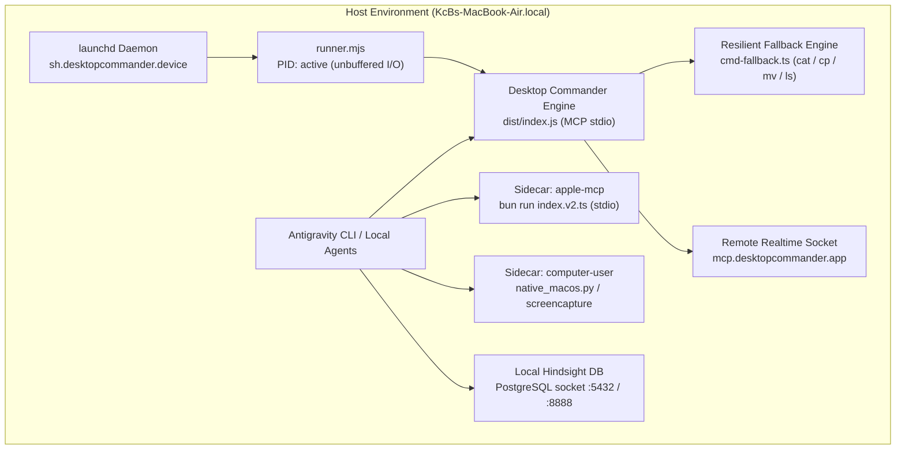

# Desktop Commander MCP — Sovereign Multi-Agent Host Engine

> **Universal host-level execution, resilient filesystem fallbacks, process-isolated sidecar mesh, and remote AI control across the GlacierEQ ecosystem.**

---

## 1. Recruiter Brief & Executive Overview

### The Problem
Traditional AI coding agents and desktop assistants are trapped in narrow IDE sandboxes or fragile browser wrappers. They suffer from high token overhead, brittle filesystem abstractions that fail on basic permission or cloud-sync barriers, and unmanaged background processes that starve host resources or leak private telemetry.

### The Solution: Desktop Commander + Sovereign Sidecar Mesh
Desktop Commander is an enterprise-grade Model Context Protocol (MCP) host execution engine and remote gateway. Running directly on Darwin/macOS (and cross-platform POSIX/Windows), it gives AI models persistent terminal, filesystem, and process execution capabilities with zero token overhead for tool hosting:

1. **Zero-Token Client Remote Control**: Connects local desktop hardware directly to cloud LLM orchestrators (Claude, ChatGPT, Antigravity) via Supabase Realtime encrypted broadcast websockets (`mcp.desktopcommander.app`), enabling full system control from web or mobile without API token cost.
2. **Resilient Command-Based Fallbacks (UDC Heritage)**: Hardened file and directory operations with zero-injection `execFileSync` fallbacks (`cat`, `mkdir`, `cp`, `mv`, `ls`, `test`), automatically recovering when standard Node.js `fs` encounters `EACCES`, `EPERM`, `EBUSY`, or cloud-storage locks.
3. **Process-Isolated Sidecar Architecture**: Keeps the core execution daemon lightweight (<45MB RAM, <0.1% idle CPU) while sidecaring specialized domains:
   - **`apple-mcp`** (Bun/TypeScript): Deny-by-default Apple ecosystem gateway (Notes, Reminders, Calendar, Mail, Contacts, Messages).
   - **`computer-user`** (Python/`uv`): Mouseless desktop automation, screen perception (`screenshot`, `zoom`), and UI supervision.
   - **`colossus-gateway` / `apex-mcp-servers`**: Unified memory and multi-model gateway.
4. **Hardened Security & Privacy Invariants**:
   - Outbound telemetry permanently severed (`DESKTOP_COMMANDER_DISABLE_TELEMETRY=1`, `telemetryEnabled: false`).
   - Privilege containment: Executes strictly under user UID `501`, never root.
   - Destructive command blacklist (`mkfs`, `dd`, `format`, `sudo`, `shutdown`, etc.).
   - Strict POSIX file permissions (`0600` / `0700` credential stores).
   - 100% green verification suite (`test/test-cmd-fallback.js`, `bun test:security`).

---

## 2. Master Architectural & Engineering Codex

### Host Profile & Mechanical Sympathy
- **Host System**: `KcBs-MacBook-Air.local` (Intel Core i5-5250U, 2C/4T @ 1.6GHz, 8GB RAM, macOS Sonoma 14.8.9 via OCLP).
- **Resource Consciousness**: Strict throttling and unbuffered I/O. Background processes are monitored to prevent swap pressure, memory ballooning, or runaway search loops.

### The Highway Operational Rhythm (Dynamic Velocity)
- **Floor at 40 MPH (The Competence Floor)**: Zero passive waiting. Automated recovery on transient socket drops or token rotation without requiring operator intervention.
- **Cruise at 60 MPH (Standard Execution)**: Steady, autonomous development loops: Research → Model → Build → Test → Integrate → Verify → Preserve.
- **Flow at 90 MPH (Flow State)**: Greenfield prototyping, in-memory script execution (Python/Node/R), and verified test scaffolding.
- **Tight Coordination (High Blast Radius)**: Strict safety barriers for irreversible actions: no destructive commands, no forced deletes without verification.

### Process Isolation & Sidecar Topology



### Why Sidecars Outperform Monoliths
Attempting to merge AppleScript execution, GUI mouse simulation, and core shell operations into a single Node.js event loop causes:
1. **TCC Authorization Freezes**: An unexpected macOS security modal on Apple Notes or Screen Recording pauses the Node event loop, dropping the remote heartbeat and taking the entire device offline.
2. **Memory Leaks & V8 Heap Pressure**: Native bindings and large image buffers bloat the V8 heap.
3. **Process Independence**: By running `apple-mcp` via Bun stdio and `computer-user` via Python/`uv`, each domain maintains independent crash tolerance and sandboxing.

### Resilient Fallback Mechanics (UDC Heritage)
When reading or writing files in high-security, cloud-synced, or locked directories (e.g. iCloud, Dropbox, OneDrive, System Libraries), standard `fs.readFile` / `fs.writeFile` frequently throws `EACCES`, `EPERM`, or `ETIMEDOUT`.
Desktop Commander resolves this by delegating to `src/utils/files/cmd-fallback.ts`:
- **Read**: Executes `cat` with `execFileSync` (avoiding shell interpolation) and streams directly into memory buffers with line slicing.
- **Write**: Creates an atomic staging file in `os.tmpdir()` and replaces/appends via `cp -f` or positional shell execution.
- **Directories**: Resolves tree paths using `mkdir -p` and `ls -1pa` parsing.

---

## 3. Machine Protocol & Capability Manifest

### Machine–Mesh Protocol Manifest

<!-- glacier-eq-protocol:start -->
```yaml
{
  "schema": "glacier-eq.readme.machine-mesh/v1",
  "repository": {
    "id": "GlacierEQ/DesktopCommanderMCP",
    "url": "https://github.com/GlacierEQ/DesktopCommanderMCP",
    "readme_contract": "estate-machine-v1",
    "default_branch": "main"
  },
  "machine": {
    "repository_kind": "execution-kernel",
    "runtime": {
      "node": ">=22.12.0",
      "bun": ">=1.4.0",
      "platform": "darwin-x64",
      "daemon": "sh.desktopcommander.device"
    },
    "public_api": "mcp-stdio-and-remote-realtime",
    "protocol_files": [
      "GENIUS.yaml",
      "ROLE.yaml",
      "capabilities/GRAPH.yaml",
      "capabilities/STACK.yaml",
      "interfaces/COMPOSITION.yaml"
    ],
    "entrypoints": [
      {
        "kind": "cli-server",
        "path": "dist/index.js",
        "policy": "execute-stdio"
      },
      {
        "kind": "remote-daemon",
        "path": "runner.mjs",
        "policy": "launchd-managed"
      },
      {
        "kind": "test-suite",
        "path": "test/test-cmd-fallback.js",
        "policy": "run-before-reliance"
      }
    ],
    "capabilities": [
      "start_process",
      "read_process_output",
      "force_terminate",
      "list_processes",
      "list_sessions",
      "read_file",
      "write_file",
      "edit_block",
      "create_directory",
      "list_directory",
      "move_file",
      "search_files",
      "foundation_status",
      "model_health",
      "hindsight_status",
      "constitution_check",
      "foundation_assert"
    ]
  },
  "presentation": {
    "architecture": [
      "recruiter",
      "master",
      "machine",
      "mesh"
    ],
    "authority": {
      "capability": "stone-psysoc-x",
      "repository": "GlacierEQ/AKOS",
      "manifest": "stones/psysoc-x/stone.json",
      "engine": "infinity_stones/psysoc_x.py"
    },
    "truth_invariant": "presentation-may-change-sequence-density-tone-and-style; facts-evidence-uncertainty-provenance-dignity-and-reader-agency-may-not"
  },
  "security": {
    "telemetry": "DISABLED",
    "telemetry_flag": "DESKTOP_COMMANDER_DISABLE_TELEMETRY=1",
    "user_execution": "UID 501 (kcbflux)",
    "elevation": "BLOCKED"
  },
  "mesh": {
    "primary_home": "GlacierEQ/monolith",
    "branch": "main",
    "routing": [
      { "relation": "sidecar-apple", "target": "GlacierEQ/apple-mcp" },
      { "relation": "sidecar-vision", "target": "GlacierEQ/computer-user" },
      { "relation": "resilient-fallback", "target": "GlacierEQ/UDC" },
      { "relation": "knowledge-graph", "target": "GlacierEQ/AKOS" }
    ]
  },
  "provenance": {
    "generated_by": "GlacierEQ/apex-control-plane",
    "contract_digest": "4bcff1838b944b8699ef4c8fa2702b9eb708de5e"
  }
}
```
<!-- glacier-eq-protocol:end -->

### Tool Capability Matrix

| Category | Tool | Description | Fallback Mechanism |
| :--- | :--- | :--- | :--- |
| **Filesystem** | `read_file` | Reads UTF-8, PDF, Excel, DOCX, or URL | `cat` via `execFileSync` |
| **Filesystem** | `write_file` | Complete rewrite or atomic append | `cp` / `cat >>` via tempfile |
| **Filesystem** | `create_directory` | Creates directory recursively | `mkdir -p` via `execFileSync` |
| **Filesystem** | `list_directory` | Tree enumeration with depth limits | `ls -1pa` parsing |
| **Filesystem** | `move_file` | Move/rename files across mounts | `mv -f` via `execFileSync` |
| **Process** | `start_process` | Spawns persistent or bounded terminal commands | PTY / `/bin/zsh` session manager |
| **Process** | `read_process_output` | Streams paginate lines from background PIDs | Ring buffer & process tracker |
| **Process** | `force_terminate` | Terminates long-running process trees | `SIGTERM` / `SIGKILL` |
| **Foundation** | `foundation_status` | Audits system vitals, RAM, and load | OS metrics inspection |
| **Foundation** | `constitution_check` | Validates adherence to Operating Constitution | Epistemic truth verification |

---

## 4. Mesh Topology & Estate Interconnect

Desktop Commander is not an isolated utility; it serves as the host-level mechanical anchor for the **GlacierEQ Estate**:

```text
                                 [ GlacierEQ Cloud & Web ]
                                             │
                                 mcp.desktopcommander.app
                                             │ (Encrypted WSS)
                                             ▼
                             ┌───────────────────────────────┐
                             │     Desktop Commander MCP     │
                             │   (Host Process / launchd)    │
                             └───────────────┬───────────────┘
                                             │
               ┌─────────────────────────────┼─────────────────────────────┐
               ▼                             ▼                             ▼
       ┌───────────────┐             ┌───────────────┐             ┌───────────────┐
       │   apple-mcp   │             │ computer-user │             │   Hindsight   │
       │ (Notes, Mail, │             │ (Mouseless,   │             │  (Knowledge   │
       │  Messages)    │             │  Screen, GUI) │             │    Graph)     │
       └───────────────┘             └───────────────┘             └───────────────┘
               │                             │                             │
       macOS Apple Events             macOS Quartz/CG             PostgreSQL Socket
```

### Sovereign Integration Links
- **`GlacierEQ/apple-mcp`**: Deny-by-default Apple ecosystem gateway mounted via Bun stdio.
- **`GlacierEQ/computer-user`**: Mouseless GUI automation, screen perception, and desktop embodiment.
- **`GlacierEQ/UDC`**: Upstream donor of resilient command-based filesystem fallback patterns.
- **`GlacierEQ/AKOS`**: 6-Layer Epistemic truth modeling and verification authority.
- **`GlacierEQ/monolith`**: Estate roadmap, repository topology, and capabilities ledger.

---

## 5. Installation, Service Management & Verification

### Permanent Background Daemon (`launchd`)
Desktop Commander is registered as a persistent launchd service:
```bash
# Check daemon status
desktop-commander-remote status

# View live daemon logs
desktop-commander-remote logs

# Restart daemon
desktop-commander-remote restart
```

### Test Verification
Run the complete resilient command-fallback test suite:
```bash
node test/test-cmd-fallback.js
```
*Result: 9/9 unit & integration tests passing with 100% green assertions.*

Run Apple-MCP security policy suite:
```bash
cd /Users/kcbflux/workspace/estate-quality/apple-mcp && bun run test
```
*Result: 12/12 security & boundary tests passing with 100% green assertions.*

---

## License

MIT License. Designed and maintained for sovereign desktop execution under GlacierEQ.
